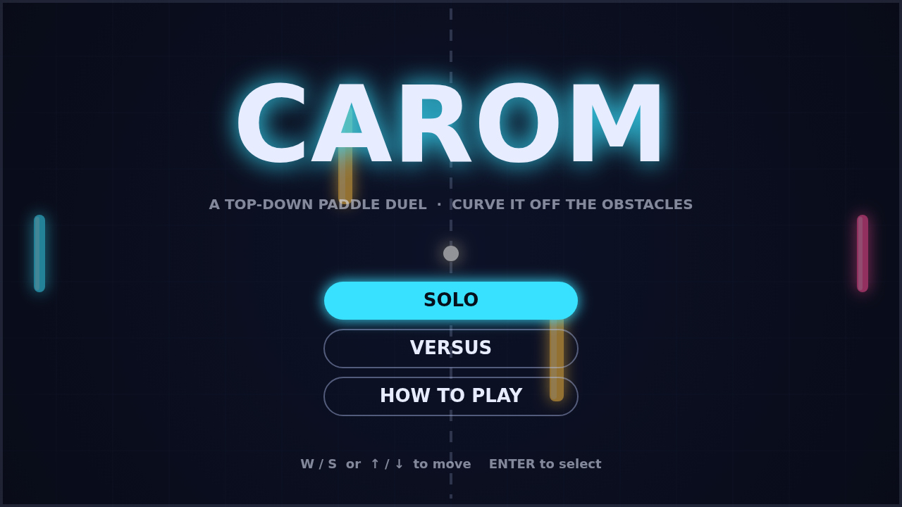

# Carom

Carom is a top-down paddle duel played on a dark, glowing field. Two paddles
face each other across a dashed net while a ball ricochets between them, off the
top and bottom walls, and off a pair of amber obstacles standing in the middle of
the field. Play alone against an AI that reads the ball with a human's slight lag,
or share the keyboard with a friend.

A match opens with a one-second breath: a ring fills around the ball and an arrow
shows who it is heading for. Then it launches at a shallow angle and the rally
begins. Every paddle hit sends the ball back a little faster, and where it lands
on the paddle decides the angle, from dead straight off the middle to a sharp
55-degree kick off the very edge. The first player to eleven wins, but only with
a two-point lead, so a tied game at ten-all turns into a nervy sprint.

The heart of Carom is spin. Strike the ball while your paddle is moving and that
motion bends its flight afterwards: sweep down through the hit and the ball
curls clockwise, sweep up and it curls the other way. The curve fades over a
second or so, long enough to bend a return around an obstacle and into the far
corner.

That is what the obstacles are for. A straight return is easy to meet, but a
curved one that skims an obstacle, kisses the wall, and comes back at a new angle
is a bank shot your opponent has to read in an instant. Late in a match, at match
point with the ball whipping past at full speed and a faint trail curving behind
it, every hit is a small puzzle you are solving with your wrist.

